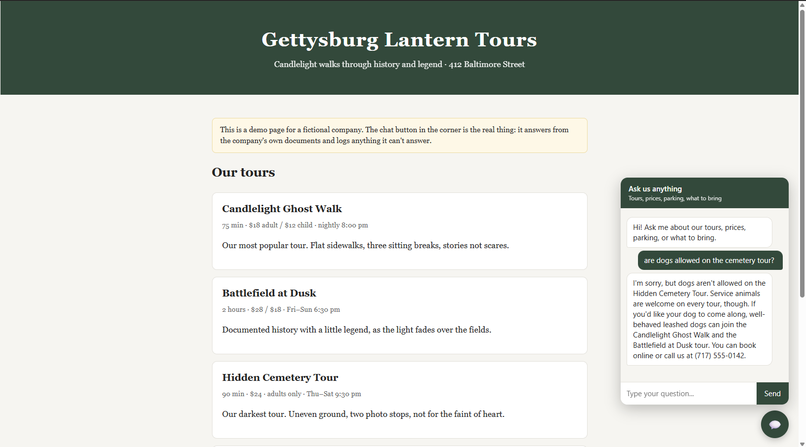
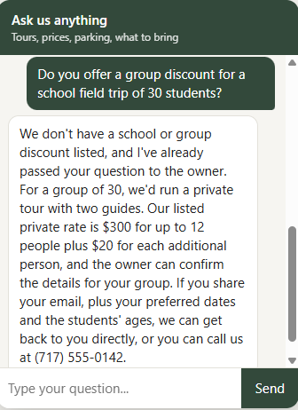
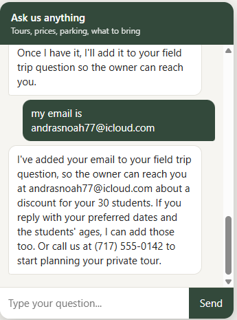
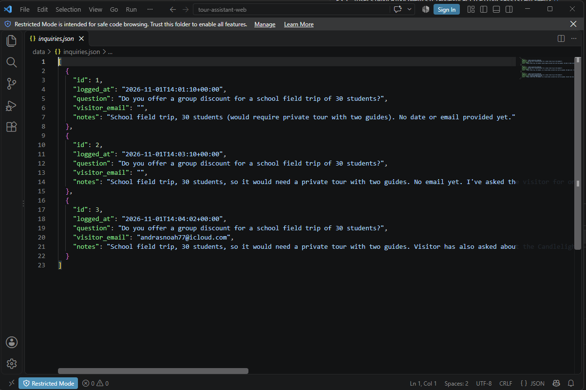

# Tour Assistant, web edition

The visitor assistant as a chat widget a small business can put on its website.
One Python server, one JavaScript file, one line of HTML to install. Powered by
Claude through the Anthropic API.

This is the deployable version of [tour-assistant](https://github.com/nandras19/tour-assistant)
(the Claude Code project) and [tour-assistant-local](https://github.com/nandras19/tour-assistant-local)
(the hand-written agent loop). Same documents, same rules, same `log_inquiry` tool.

## Demo video

[](https://www.youtube.com/watch?v=or8hoGJqh48)

One minute: a visitor asks the widget a question the documents answer, then
one they don't, and the owner's inquiry log fills in.
[Watch on YouTube](https://www.youtube.com/watch?v=or8hoGJqh48).

## What a visitor sees

A round chat button in the corner of the website. They ask "which tour is good
for a 6-year-old?" and get a specific answer with the price and time, in a few
seconds. If they ask something the business hasn't written down, the assistant
says so, asks for their email, and the owner gets the question in a list.

## Screenshots

**A question the documents answer.** The widget on the demo homepage. The
visitor asks whether dogs are allowed on the cemetery tour; the answer comes
straight from the policies document, including which tours do allow leashed
dogs, and ends with how to book.



**A question the documents don't answer.** A teacher asks about a group
discount for 30 students. There is no school discount in the documents, so the
assistant says so, logs the question for the owner, gives the private-tour
pricing that *is* written down, and asks for an email.



**The visitor adds their email.** The assistant logs the question again with
the email attached, so the owner has a way to reply.



**What the owner sees.** `data/inquiries.json` after that conversation: the
question, the visitor's email once they gave it, and notes with the context
(group size, that it would need a private tour with two guides).



## What the owner gets

- Fewer repeat emails. The documents answer them.
- A list of questions the assistant couldn't answer, each a lead or a gap in the
  website, at `/api/inquiries?token=...`.
- Nothing to install on their computer. The widget is one line in their site.

## How it works

```
visitor's browser                 this server (Flask)              Anthropic
┌───────────────┐   POST /api/chat  ┌──────────────────┐  messages   ┌────────┐
│  widget.js    │ ───────────────▶ │ server.py        │ ──────────▶ │ Claude │
│  chat panel   │ ◀─────────────── │ keeps the chat   │ ◀────────── │        │
└───────────────┘    {reply}        │ runs log_inquiry │  tool call  └────────┘
                                    └────────┬─────────┘
                                             ▼
                                   data/inquiries.json
```

- **`server.py`** loads the four documents in `docs/` into Claude's system prompt
  once, with prompt caching so repeat requests cost about a tenth. Each visitor's
  conversation is kept in memory under a random id that lives only as long as
  the page is open; a refresh starts a new conversation and nothing is stored in
  the visitor's browser. When Claude asks to call `log_inquiry`, the server runs it and sends
  the result back, the same loop as the local version.
- **`static/widget.js`** draws the chat button and panel and posts messages to
  the server. No framework, about 100 lines.
- **`static/index.html`** is a fake company homepage showing the widget in place.

## Run it locally

Requirements: Python 3.11+ and an Anthropic API key.

```bash
pip install -r requirements.txt
```

Copy `.env.example` to `.env` and paste your API key in. Then:

```bash
python server.py
```

Open http://localhost:5000 and click the chat button.

## Put it on a client's website

1. Run `server.py` somewhere public (any small host that runs Python: Render,
   Railway, Fly.io, a $5 VPS). Set `ANTHROPIC_API_KEY` and `OWNER_TOKEN` there.
2. Replace the files in `docs/` with the client's tour list, FAQ, and policies,
   and change the company name in `SYSTEM_RULES` in `server.py`.
3. Add this line to their website, with your server's address:

```html
<script src="https://your-server.example/widget.js" defer></script>
```

## Costs

A visitor question is roughly 3,000 cached input tokens and 150 output tokens
on Claude Opus 5.5. At current prices that is well under a cent per question,
so a business getting a few hundred questions a month pays a few dollars in API
usage. Change `MODEL` in `.env` to `claude-sonnet-5-5` to halve it.

## Not done yet (what a real deployment adds)

- Conversations live in server memory. A restart forgets them. A real version
  stores them in a small database.
- No rate limiting on `/api/chat`. Add one before going public, or a bot can run
  up the API bill.
- The owner's inquiry list is a JSON page behind a token. A real version emails
  the owner or shows a simple page.

## What I learned

- The three versions share one design: documents, a grounding rule, one tool.
  Only the harness changed: Claude Code, then a hand-written loop on a local
  model, then this web service.
- Keeping the whole set of documents in a cached system prompt is simpler and
  faster than giving the model a `read_doc` tool when the documents are small.
- The widget is the part a client actually sees. It had to be one line to
  install, or the walk-in pitch of "I'll set it up on your site" isn't true.
